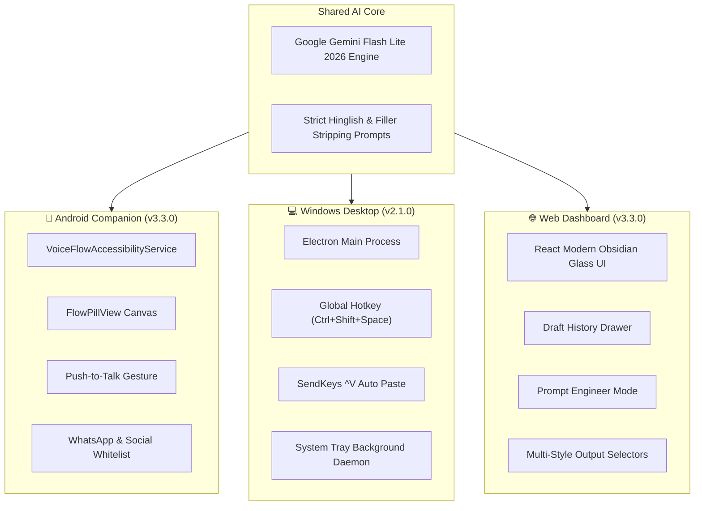

# 🏷️ VoiceFlow Platform Version Matrix

This document defines the current version tracks, component boundaries, and compatibility standards across the VoiceFlow ecosystem.

---

## Current Platform Versions

| Platform | Folder Path | Version | Primary Tech Stack | Status |
| :--- | :--- | :--- | :--- | :--- |
| **Android Companion** | [android/](file:///android/) | **`v3.3.0`** | Java 17, Android Accessibility Service, MediaRecorder, Canvas | 🟢 Production Ready |
| **Windows Desktop** | [windows/](file:///windows/) | **`v2.1.0`** | Electron, Node.js, C# (.NET WinForms), PowerShell SendKeys | 🟢 Production Ready |
| **Web Dashboard** | [src/](file:///src/) | **`v3.3.0`** | React 18, Vite 5, Tailwind CSS, Web Audio API | 🟢 Production Ready |
| **Global Ecosystem** | Root Repository | **`v3.3.0`** | Google Gemini Multimodal REST API, Capacitor 6 | 🟢 Production Ready |

---

## Platform Responsibilities & Boundaries

---

## One-Click Execution Commands (Root `package.json`)

All platform tasks can be run directly from the workspace root:

| Command | Target | Action Performed |
| :--- | :--- | :--- |
| `npm run dev:web` | Web Dashboard | Starts Vite local dev server on `http://localhost:5173` |
| `npm run start:windows` | Windows Desktop | Launches the Electron desktop app with global hotkey support |
| `npm run build:android` | Android Sync | Builds production web bundle and syncs assets into Android assets |
| `npm run build:apk` | Android APK | Compiles native debug APK (`assembleDebug`) |
| `npm run build:windows` | Windows Executable | Builds portable standalone `VoiceFlow.exe` via `electron-builder` |
| `npm run build:all` | All Platforms | Builds web, syncs Android, and compiles native debug APK in sequence |

---

## Git Tagging Standard

When cutting a release, tag commits according to the affected platform:
- Global Release: `v3.3` (or `v3.3.0`)
- Android Specific: `android-v3.3.0`
- Windows Specific: `windows-v2.1.0`
- Web Specific: `web-v3.3.0`

